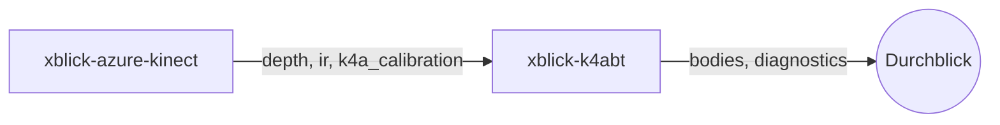

# Design of xblick-k4abt

This page explains how the tracker works inside, which decisions we made and why, and which special cases of the
Body Tracking SDK the code handles. Read it before you simplify a part of the build or of the run-time setup.

## Overview



Three decisions shape the tracker.

**Body tracking is a separate process.** The tracker needs a capture with depth and IR of one exposure, and the
calibration of the device. Both cross the process boundary without loss. Depth and IR travel as 16-bit frames, and the
tracker pairs them by their common stamp. The calibration travels as the raw record, from which
`k4a_calibration_get_from_raw` rebuilds exactly the device's `k4a_calibration_t`. Microsoft's own offline processing
feeds the tracker in the same way, with captures from recordings. The camera node does not know about body tracking,
so several trackers or none can run.

**The tracker is a repository of its own.** The camera node needs the Sensor SDK, its depth engine and EGL. The
tracker needs the Body Tracking SDK, ONNX Runtime, cuDNN, TensorRT and a CUDA toolkit, 11 GB in all. Each repository
installs only what its program needs, and a project that builds on one of them needs only that one.

**Body results use the SDK's body model.** They use the model `K4ABT_BODY_32` with its 32 joints, millimetres and the
depth camera's frame.

## Decisions

The project is a plain CMake project with the program and the library `xblick_k4abt`. Other programs build on the
installed CMake package `xblick_k4abt_lib`. The table lists the decisions that a simplification could undo by accident.

| Decision | Reason | Cost |
| --- | --- | --- |
| Body tracking uses a current ONNX Runtime through `src/onnxruntime_compat.cpp`, a stand-in for the SDK's `libonnxruntime.so.1.10.0`. TensorRT is the default mode. | With the SDK's ONNX Runtime 1.10, GPUs of compute capability 10 and newer (Blackwell) return no bodies. TensorRT takes 7.0 ms per frame, and CUDA takes 16.4 ms. | The host needs ONNX Runtime 1.31.1, TensorRT 10.14.1, cuDNN 9 and a CUDA 12 or 13 toolkit. The Body Tracking SDK still brings CUDA 11.2, which only the SDK's own runtime would use. |
| The programs find libraries at run time through their RPATH. They do not use `LD_LIBRARY_PATH`. | See "Libraries at run time". | `CMakeLists.txt` contains linker options for it. |
| The tracker reads the calibration record with its own copy of the camera's code (`src/calibration.*`), in the namespace `xblick::k4a_record`. | The tracker builds without the camera's repository. The namespace keeps the copy apart from the camera's own in a program that links both libraries. | The record's format is defined twice. A change of the record in xblick-azure-kinect needs the same change here, and both raise `kCalibrationRecordVersion`. |
| The CMake package is `xblick_k4abt_lib`, not `xblick_k4abt`. | A project that wraps the tracker for a framework is naturally named `xblick_k4abt`, and such frameworks often export a CMake package under the project's name. The two names must differ. | The package name and the repository name differ. |
| Monitoring uses `<base>/diagnostics` with ROS's message. | Rerun and `xblick diagnostics` read the diagnostics. | A monitor of another framework has to read the topic or receive the report from the program that embeds the tracker. |
| The calibration record has version 2, with the camera node's calibration files. | With K and D of the files in the SDK's calibration, the tracker uses the intrinsics of the camera's streams. | Camera nodes and trackers of another record version refuse each other. |

## Results

Each result on `<base>/bodies` is one JSON object:

```json
{"v": 1, "model": "K4ABT_BODY_32", "stamp_ns": 1763480000000000000, "frame_id": "AzureKinectDepthCamera",
 "latency_ms": 11.2,
 "bodies": [{"id": 1, "joints": {"Pelvis": {"position_mm": [x, y, z], "orientation_wxyz": [w, x, y, z],
                                            "confidence": 2}, ...}}]}
```

`stamp_ns` is the stamp of the depth frame that the tracker worked on. `latency_ms` runs from that stamp to the
result. `confidence` is the SDK's level: 0 none (out of view), 1 low (occluded, predicted), 2 medium. SDK 1.1 does not
produce the level 3, high.

Durchblick's publishers write the attachments of the camera streams. `xblick-k4abt` writes the attachment of the
bodies itself, as the same object with these fields:

| Field | Value |
| --- | --- |
| `v` | the version of the attachment |
| `seq` | a counter with one step per sample |
| `publish_called_ns` | the time at which the tracker has its result, before it serializes it |
| `publish_ns` | the time right before the put |
| `source` | the source name |

## Libraries at run time

A workspace that sets `LD_LIBRARY_PATH` for all its programs puts every library there first. If cuDNN or TensorRT were
there, they would replace PyTorch's own libraries, for example. The programs therefore find the libraries that only the
tracker needs through their RPATH.

An ELF program can name library directories in two ways. The loader searches `DT_RPATH` before `LD_LIBRARY_PATH`, and
it searches `RUNPATH` after `LD_LIBRARY_PATH`. Modern linkers write `RUNPATH` by default.

| Library | How the program finds it |
| --- | --- |
| The ONNX Runtime stand-in | Through `DT_RPATH`, which the option `-Wl,--disable-new-dtags` selects. The SDK's own `libonnxruntime.so.1.10.0` is usually on `LD_LIBRARY_PATH` and would win over a `RUNPATH`. |
| ONNX Runtime 1.31.1 | Through the `RUNPATH` of the stand-in. |
| The CUDA toolkit's libraries | Through the `DT_RPATH` of the executable. The stand-in's CMake target adds the toolkit's library directory to it. |
| cuDNN 9 | Through the `DT_RPATH` of the executable. `XBLICK_K4A_CUDNN_DIR` adds `<cuDNN>/lib` to it. Without that option, cuDNN has to be in the CUDA toolkit's library directory. |
| TensorRT | Through the `DT_RPATH` of the executable. `XBLICK_K4A_TENSORRT_DIR` adds `<TensorRT>/lib` to it. |
| The depth engine | `libk4a` loads it when it starts and finds it through its own `RUNPATH` `$ORIGIN/libk4a1.4`, where Microsoft's package puts it. The tracker does not use it. Without it, or without `libGL` and `libX11`, `libk4a` logs three errors and the tracker works. |

ONNX Runtime's CUDA and TensorRT providers have no `RUNPATH` of their own. They find their libraries through the
`DT_RPATH` of the executable. The exported CMake targets pass these directories on to the programs that link them.

Installed programs keep these directories, because the project sets `CMAKE_INSTALL_RPATH_USE_LINK_PATH`. They find
this project's own libraries in `../lib`. Without that setting CMake drops the directories at install.

## Special cases of the Body Tracking SDK

### New GPUs

The Body Tracking SDK brings CUDA 11, cuDNN 8, TensorRT 8 and ONNX Runtime 1.10. These have no kernels for new GPUs
such as the RTX PRO 6000 with compute capability 12.0. Every inference fails there, and the SDK still returns frames,
without bodies and without an error.

The SDK uses ONNX Runtime only through its C API: `OrtGetApiBase` and two functions that append the CUDA provider and
the TensorRT provider. `xblick-k4abt` can therefore give it a current ONNX Runtime
(`XBLICK_K4A_ONNXRUNTIME_DIR`, for example `onnxruntime-linux-x64-gpu_cuda12-1.31.1`). That release has kernels
for Turing, Ampere, Ada and Blackwell, which are sm_75, 86, 89 and 120.

`src/onnxruntime_compat.cpp` builds a `libonnxruntime.so.1.10.0` with the symbol version that the SDK imports. It
forwards every call to the current ONNX Runtime, with two differences:

| Difference | Reason |
| --- | --- |
| It skips the SDK's `ReleaseEnv` at process exit. | With the CUDA provider that call corrupted the heap. |
| It turns TF32 off. | With TF32 the joints moved by up to 35 mm against the SDK's own processing, and by up to 96 mm with TensorRT. |

ONNX Runtime has no provider option for TensorRT's TF32. The library therefore sets `NVIDIA_TF32_OVERRIDE=0` when the
SDK appends the TensorRT provider. It refuses another value of that variable.

With the stand-in, every joint is within 1 mm of the SDK's own ONNX Runtime on the CPU, with CUDA and with TensorRT
10.14.1. We measured this on the RTX PRO 6000 with a rendered mannequin (`tests/test_body_tracking.cpp`).
[performance.md](performance.md) has the times.

In a build with the SDK's own ONNX Runtime, `xblick-k4abt` refuses GPUs of compute capability 10 and newer.

### TensorRT engine cache

TensorRT builds its engine at the first start, which takes 10 s. It keeps the engine in the directory of
`--tensorrt-cache`, which is the node's cache directory `~/.cache/xblick/k4abt` by default (Durchblick's
[files page](https://github.com/xblick/xblick/blob/main/docs/reference/files.md) names the variables that move it).
The cache needs 240 MB per GPU architecture. It has one subdirectory per ONNX Runtime and TensorRT version, for
example `onnxruntime-1.31.1_tensorrt-10.14.1.48`. The program deletes the subdirectories of other versions at the
start, because engines of another TensorRT do not load. It touches only directories with names of that form, so the
prerequisites of `tools/setup.sh` in the same directory stay.

### Masks

`xblick-k4abt` sets depth and IR outside a region to 65535 before tracking, so that it tracks no bodies there.
The options `--mask-min-x`, `--mask-max-x` and `--mask-max-z` set the region.
