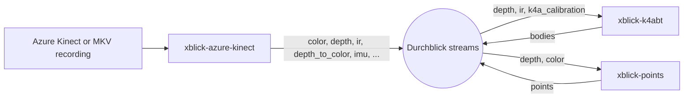

# Design of xblick-azure-kinect

This page explains how the node works inside, which decisions we made and why, and which special cases of the Azure
Kinect the code handles. Read it before you simplify a part of the build or of the run-time setup.

## Overview

Three decisions shape the node.

**Colour stays MJPEG.** The camera sends MJPEG. The SDK's BGRA32 format only means that the SDK decodes the MJPEG on
the CPU. The node asks the SDK for MJPEG and passes the bytes on with Durchblick's `publish_jpeg`. It decodes a frame
only for subscribers that read pixels.

**Body tracking is a separate process.** The tracker needs a capture with depth and IR of one exposure, and the
calibration of the device. Both cross the process boundary without loss. Depth and IR travel as 16-bit frames, and the
tracker pairs them by their common stamp. The calibration travels as the raw record, from which
`k4a_calibration_get_from_raw` rebuilds exactly the device's `k4a_calibration_t`. Microsoft's own offline processing
feeds the tracker in the same way, with captures from recordings. The camera node does not know about body tracking,
so several trackers or none can run.

**Body results use the SDK's body model.** They use the model `K4ABT_BODY_32` with its 32 joints, millimetres and the
depth camera's frame.

## Decisions

The project is a plain CMake project with the programs and the library `xblick_k4a`. Other programs build on the
installed CMake package. The table lists the decisions that a simplification could undo by accident.

| Decision | Reason | Cost |
| --- | --- | --- |
| The depth engine gets its OpenGL context through EGL (`libxblick_k4a_egl.so`). | The SDK needs an X display for it, and the camera's host has none. | We maintain 15 Xlib and GLX functions of our own. See "Depth engine". |
| Body tracking uses a current ONNX Runtime through `src/onnxruntime_compat.cpp`, a stand-in for the SDK's `libonnxruntime.so.1.10.0`. TensorRT is the default mode. | With the SDK's ONNX Runtime 1.10, GPUs of compute capability 10 and newer (Blackwell) return no bodies. TensorRT takes 7.0 ms per frame, and CUDA takes 16.4 ms. | The host needs ONNX Runtime 1.31.1, TensorRT 10.14.1 and CUDA 12.8. The Body Tracking SDK still brings CUDA 11.2, which only the SDK's own runtime would use. |
| The programs find libraries at run time through their RPATH. They do not use `LD_LIBRARY_PATH`. | See "Libraries at run time". | `CMakeLists.txt` contains linker options for it. |
| Monitoring uses `<base>/diagnostics` with ROS's message. | Rerun and `xblick diagnostics` read the diagnostics. | A monitor of another framework has to read the topic or receive the report from the program that embeds the node. |
| The IMU is one `sensor_msgs/Imu` per sample, only while a subscriber exists. | It is ROS's message. | A subscriber receives about 1600 small messages per second. |
| Durchblick's generic point cloud node computes the point clouds, by default in the depth camera's geometry. The camera node computes none. | The node computes each cloud once on the GPU for every reader, and only while a reader exists. The same node serves every depth camera and uses ROS's `PointCloud2` layout. | A further process runs beside the camera. Durchblick needs `XBLICK_POINTS`, which needs a CUDA toolkit with `nvcc`. A reader on another host gets the whole cloud of 5.9 MB, or it starts its own node there. A cloud in the colour camera's geometry is available with `depth_to_color` as input. |
| Rectified colour is a separate stream `color_rect` beside `color`. | Each reader chooses, and no reader pays for a stream that nobody reads. | The node has a second representation of the colour image. It decodes and remaps per frame while a subscriber exists. |
| Calibration files have ROS's format, and the node puts them into the SDK's calibration. | ROS's `camera_calibration` writes them. With K and D in the SDK's calibration, `depth_to_color`, body tracking and point clouds agree with the `CameraInfo` of the streams. | A file replaces only the intrinsics, and the extrinsics stay the factory values. The calibration record has version 2, so camera nodes and trackers of the older version refuse each other. |
| The build includes body tracking when `k4abt_DIR` is in the environment. | An environment that provides the Body Tracking SDK sets `k4abt_DIR`, and the build follows it without a CMake definition. | With `k4abt_DIR` set and without an ONNX Runtime directory, the build stops and names the unset variable `XBLICK_K4A_ONNXRUNTIME_DIR`. |

## Libraries at run time

A workspace that sets `LD_LIBRARY_PATH` for all its programs puts every library there first. If CUDA 12.8's cuDNN or
TensorRT were there, they would replace PyTorch's own libraries, for example. The programs
therefore find the libraries that only the tracker needs through their RPATH.

An ELF program can name library directories in two ways. The loader searches `DT_RPATH` before `LD_LIBRARY_PATH`, and
it searches `RUNPATH` after `LD_LIBRARY_PATH`. Modern linkers write `RUNPATH` by default.

| Library | How the program finds it |
| --- | --- |
| The ONNX Runtime stand-in | Through `DT_RPATH`, which the option `-Wl,--disable-new-dtags` selects. The SDK's own `libonnxruntime.so.1.10.0` is usually on `LD_LIBRARY_PATH` and would win over a `RUNPATH`. |
| ONNX Runtime 1.31.1 | Through the `RUNPATH` of the stand-in. |
| CUDA 12.8 with cuDNN | Through the `DT_RPATH` of the executable. The directory is in it because the node links nvJPEG. |
| TensorRT | Through the `DT_RPATH` of the executable. `XBLICK_K4A_TENSORRT_DIR` adds `<TensorRT>/lib` to it. |
| The depth engine | From `LD_LIBRARY_PATH`. `libk4a` opens it by name. |

ONNX Runtime's CUDA and TensorRT providers have no `RUNPATH` of their own. They find their libraries through the
`DT_RPATH` of the executable. The exported CMake targets pass both directories on to the programs that link them.

Installed programs keep these directories, because the project sets `CMAKE_INSTALL_RPATH_USE_LINK_PATH`. They find
this project's own libraries in `../lib`. Without that setting CMake drops the directories at install.

## Special cases of the Azure Kinect

We found these in the SDK and in our measurements.

### Depth engine

The SDK computes depth from the raw IR image on the host GPU with OpenGL. The library is `libdepthengine.so.2.0`. It
is closed source and must be on `LD_LIBRARY_PATH`. The SDK's transformation, which produces `depth_to_color`, runs
there too.

The depth engine gets its OpenGL 4.4 context through Xlib and GLX. With the SDK alone it therefore needs an X display.
On a headless host it fails with error 204, a GPU API failure.

This node needs no X display. `libxblick_k4a_egl.so` (`src/egl_glx.cpp`) defines the 15 Xlib and GLX functions
that the depth engine imports. It creates the context with EGL on the NVIDIA GPU that `--depth-engine-gpu` names, as
a CUDA device ordinal.

The host needs NVIDIA's EGL (`libEGL_nvidia`, part of the driver) and GLVND's `libGL` and `libX11`, because the depth
engine still loads them. It needs no running X server.

We checked this on a headless host: the transformation agrees with the SDK's CPU projection within 1.8 mm.

Without the plugin, the SDK's transformation returns a null handle and reports no error. The node checks the handle
and names the cause.

### depth_to_color on the CPU

The node computes `depth_to_color` and `depth_to_color_rect` on the CPU (`src/depth_to_color.cpp`). The SDK's
transformation waits for GPU time where other programs keep the GPU busy.
[performance.md](performance.md#the-camera-on-a-busy-gpu) has the numbers. `--sdk-depth-to-color` selects the SDK's
transformation. The depth itself still comes from the depth engine.

The computation has these steps:

1. At the start, the node takes the ray of each depth pixel and the rectified position of each colour pixel from the
   SDK's `k4a_calibration_2d_to_3d`.
2. Per frame, it projects each depth pixel into the pinhole camera of `color_rect`. That image is
   `depth_to_color_rect`.
3. A depth pixel covers the pixels within its footprint there. Where two footprints overlap, the nearest depth wins.
4. Across a footprint, the depth follows the slope of the surface, which the node takes from the neighbouring depth
   pixels on the same surface. The SDK's triangles do the same. `--no-depth-to-color-interpolation` turns this off.
5. `depth_to_color` is that image, read at the rectified position of each colour pixel.

The node leaves out two kinds of pixels, as the SDK does:

| Kind | Definition | Option to keep them |
| --- | --- | --- |
| Flying pixels | A depth in the gap between a nearer and a farther neighbour. | `--keep-flying-pixels` |
| Sparse pixels | A pixel in no complete 2 x 2 square on one surface. | `--keep-sparse-pixels` |

The SDK draws such 2 x 2 squares. It keeps neighbours that are up to about 4.5 % of the depth apart, and it does not
cut by distance. `k4a_depth_to_color_check --probe-max-depth` measures this.

`--max-depth-mm` sets depths beyond a distance to 0 in every depth stream. It is off by default.

Checks:

- The `offline` test compares the CPU result with the SDK's transformation on a plane and on a box in front of it.
- `tools/k4a_depth_to_color_check` compares the `depth_to_color` of a running node with the SDK's transformation of
  the same depth frames, live.
- `tools/k4a_depth_to_color_mirror` publishes the result of the other method below another base, so that you can
  look at both.
- Live with a camera on 2026-11-10, 99.6 % of the pixels were within 5 mm of the SDK. The node produced fewer pixels
  between surfaces than the SDK, 154 against 229 per frame. The largest depths of both were alike.

### Publishing from separate threads

A publish into a CUDA ring uploads the frame. On a GPU that other programs keep busy, each upload waits. In the
capture loop the streams waited one after the other. [performance.md](performance.md#the-camera-on-a-busy-gpu) has
the numbers.

The program therefore publishes from four threads, which the code calls lanes
(`NodeOptions::async_publish`):

| Lane | Work |
| --- | --- |
| 1 | publishes colour |
| 2 | publishes depth and IR |
| 3 | computes `depth_to_color` and publishes `depth_to_color_rect` |
| 4 | publishes `depth_to_color` |

The capture thread still computes the stamps, because the device clock must see the images in order.

A lane that is still busy with the previous frame skips the older pending frame. A lane therefore never accumulates
latency. The diagnostics count these frames as "skipped by a busy lane" and then report WARN.

An exception in a lane ends the program at the next capture.

`--sync-publish` publishes in the capture loop.

### MJPEG without Huffman tables

A UVC camera may omit the Huffman tables from its MJPEG frames. libjpeg-turbo, which is the SDK's decoder, then uses
the standard tables. nvJPEG and other decoders fail. The node inserts the standard tables from libjpeg's defaults
into such a frame before it passes the frame on or decodes it. The status line counts these frames.

### Lens model

Retail devices use the Brown-Conrady model, which is OpenCV's rational model. We checked this against the SDK's
`intrinsic_transformation.c`. Early internal devices use the model Rational 6KT, which has other tangential terms.
The node refuses it.

### Stalls

`get_capture` sometimes fails. The node then restarts the cameras once. A second failure in a row
ends the program. The node drops queued captures, so that it publishes the newest one.

### Colour controls

The node sets the brightness of the colour camera to manual 128 (`color.brightness`).
The node also sets every other colour control at the start, to the SDK's default unless you give a value. Otherwise
the device would keep the values of the last session. [parameters.md](parameters.md) lists the controls.

### Body Tracking SDK on new GPUs

The Body Tracking SDK brings CUDA 11, cuDNN 8, TensorRT 8 and ONNX Runtime 1.10. These have no kernels for new GPUs
such as the RTX PRO 6000 with compute capability 12.0. Every inference fails there, and the SDK still returns frames,
without bodies and without an error.

The SDK uses ONNX Runtime only through its C API: `OrtGetApiBase` and two functions that append the CUDA provider and
the TensorRT provider. `xblick-k4abt` can therefore give it a current ONNX Runtime
(`XBLICK_K4A_ONNXRUNTIME_DIR`, for example `onnxruntime-linux-x64-gpu_cuda12-1.31.1`). That release has kernels
for Turing, Ampere, Ada and Blackwell, which are sm_75, 86, 89 and 120.

`src/onnxruntime_compat.cpp` builds a `libonnxruntime.so.1.10.0` with the symbol version that the SDK imports. It
forwards every call to the current ONNX Runtime, with two differences:

| Difference | Reason |
| --- | --- |
| It skips the SDK's `ReleaseEnv` at process exit. | With the CUDA provider that call corrupted the heap. |
| It turns TF32 off. | With TF32 the joints moved by up to 35 mm against the SDK's own processing, and by up to 96 mm with TensorRT. |

ONNX Runtime has no provider option for TensorRT's TF32. The library therefore sets `NVIDIA_TF32_OVERRIDE=0` when the
SDK appends the TensorRT provider. It refuses another value of that variable.

With the stand-in, every joint is within 1 mm of the SDK's own ONNX Runtime on the CPU, with CUDA and with TensorRT
10.14.1. We measured this on the RTX PRO 6000 with a rendered mannequin (`tests/test_body_tracking.cpp`).
[performance.md](performance.md#body-tracking) has the times.

TensorRT builds its engine at the first start, which takes 10 s. It keeps the engine in the directory of
`--tensorrt-cache`, which is `~/.cache/xblick-k4abt` by default. The cache needs 240 MB per GPU architecture. It
has one subdirectory per ONNX Runtime and TensorRT version, for example `onnxruntime-1.31.1_tensorrt-10.14.1.48`. The
program deletes the subdirectories of other versions at the start, because engines of another TensorRT do not load.

In a build with the SDK's own ONNX Runtime, `xblick-k4abt` refuses GPUs of compute capability 10 and newer.

### Masks

`xblick-k4abt` sets depth and IR outside a region to 65535 before tracking, so that it tracks no bodies there.
The options `--mask-min-x`, `--mask-max-x` and `--mask-max-z` set the region.

## Status and limits

- Nobody has tried CUDA mode with the SDK's own ONNX Runtime on Turing, Ampere and Ada GPUs.
